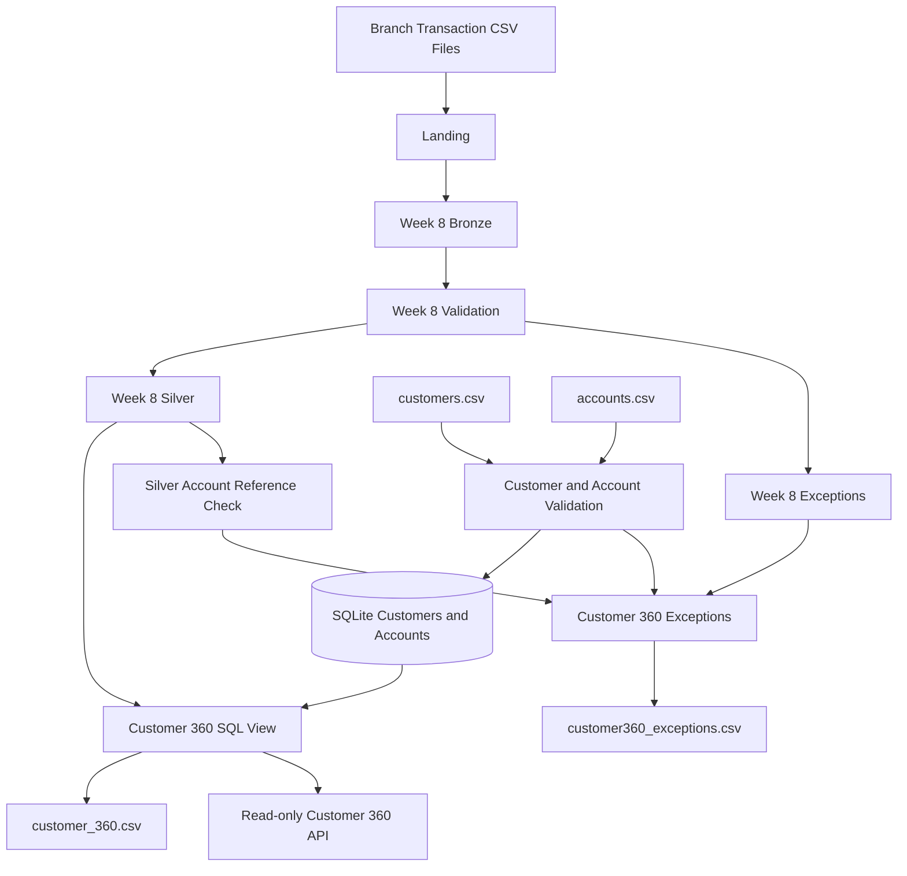

# Architecture — Week 8 CDP Readiness Extension

## 1. Overview

The Week 8 CDP Readiness Extension builds on the existing Integrated Banking Capstone.

Its purpose is to transform trusted banking transaction data into a customer-level Customer 360 data product and expose approved customer summaries through a read-only HTTP API.

The extension reuses the existing SQLite capstone database, accepted Silver transactions, and Python environment. It does not require a commercial Customer Data Platform or cloud infrastructure.

## 2. High-Level Architecture



## 3. Data Sources

The extension uses three primary inputs.

| Source | Description | Purpose |
|---|---|---|
| Week 8 Silver transactions | Accepted banking transaction records | Customer transaction metrics |
| customers.csv | Synthetic customer reference data | Customer identity and name |
| accounts.csv | Synthetic account ownership data | Connects customers to transactions |

The extension uses the following relationships:

- `customers.customer_id` identifies a customer.
- `accounts.account_id` identifies an account.
- `accounts.customer_id` identifies the account owner.
- `silver_transactions.account_id` identifies the account associated with a transaction.

The customer identity rule uses `customer_id`. Customers are not matched or merged using names alone.

The extension uses synthetic customer identifiers C001–C007. The account reference explicitly associates the existing synthetic account identifiers with these extension customer identifiers.

A synthetic account with an unknown customer reference is included to demonstrate orphan-reference validation.

## 4. Data Model and Grain

| Entity | Grain | Primary key |
|---|---|---|
| Customers | One row per customer | customer_id |
| Accounts | One row per account | account_id |
| Silver transactions | One row per accepted transaction | transaction_id |
| Customer 360 Gold | One row per customer | customer_id |
| Customer 360 exceptions | One row per rejected source record | exception_id |

### Relationships

**Customers to Accounts**

One customer can own multiple accounts. Each accepted account belongs to one valid customer.

**Accounts to Transactions**

One account can have multiple transactions. Transactions are associated with customers through the account relationship.

**Customers to Customer 360 Gold**

Each valid customer appears exactly once in the Customer 360 output, including customers without transactions.

## 5. Medallion Integration

The extension builds on the existing Week 8 Medallion pipeline.

| Existing layer or component | Responsibility |
|---|---|
| Landing | Receives original branch transaction files |
| Bronze | Preserves source transaction records and lineage |
| Silver | Stores accepted and standardized transactions |
| Week 8 Exceptions | Retains rejected transaction records and reasons |
| Customer 360 Gold | Produces one customer-level summary per customer |
| Customer 360 Exceptions | Retains extension-level rejection evidence |

The extension does not modify the existing Silver transactions or branch-level Gold summary.

## 6. Customer 360 Transformation

The Customer 360 Gold product is implemented as a SQL view named `customer_360` inside the existing SQLite capstone database.

It contains the following fields:

| Column | Description |
|---|---|
| customer_id | Unique customer identifier |
| customer_name | Customer display name |
| account_count | Number of accounts belonging to the customer |
| transaction_count | Number of mapped accepted transactions |
| total_transaction_amount | Sum of accepted transaction amounts |
| last_transaction_date | Latest transaction date, or NULL |

The transformation uses:

- Common Table Expressions (CTEs) to separate account and transaction aggregations.
- `LEFT JOIN` to preserve customers without transactions.
- `COUNT(DISTINCT ...)` is not needed for the final view because account and transaction metrics are aggregated separately.
- `COUNT(transaction_id)` to count actual transactions.
- `SUM(amount)` to calculate transaction totals.
- `MAX(transaction_date)` to identify the latest transaction date.
- `COALESCE()` to represent missing counts and totals as zero.

Separate aggregations prevent join fanout from inflating account counts and transaction totals.

The Gold view is exported to:

`output/customer360/customer_360.csv`

## 7. Data Quality and Exception Handling

The Python builder validates customer and account reference records before inserting accepted records into SQLite.

Validation includes:

- Missing customer identifiers and required customer fields.
- Duplicate customer identifiers.
- Missing account identifiers and required account fields.
- Duplicate account identifiers.
- Customer references that do not exist in the accepted customer reference.

Rejected records are stored in `customer360_exceptions` with their source filename, row number, raw record and rejection reasons.

The extension also imports existing Week 8 rejected transaction evidence and checks whether accepted Silver transactions reference accounts present in the Customer 360 account reference.

Exception output is exported to:

`output/customer360/customer360_exceptions.csv`

## 8. Database and Build Process

The extension uses the existing database:

`output/capstone/banking_capstone.db`

Main implementation:

- `sql/customer360/schema.sql` defines the extension tables, indexes and Customer 360 view.
- `src/customer360/build_customer360.py` performs reference loading, validation, exception handling, reconciliation and CSV exports.
- `src/capstone/db.py` provides the shared SQLite connection and database path.

Before rebuilding extension-owned data, the builder creates a SQLite database backup under:

`output/customer360/backups/`

The database changes to extension-owned reference and exception tables are committed transactionally.

The original Week 8 Silver transactions and branch-level Gold summary remain unchanged.

The Gold and exception CSV exports are written using temporary files before replacement. The database changes and CSV exports are not one combined atomic transaction.

## 9. Customer 360 Read-only API

The API is implemented using Python's built-in `http.server` library.

Implementation:

`src/customer360/api_server.py`

Server configuration:

| Setting | Value |
|---|---|
| Host | 127.0.0.1 |
| Port | 8765 |
| Protocol | HTTP |
| Data source | SQLite customer_360 view |
| Access | Read-only |

### Endpoint

```http
GET /customers/<customer_id>/summary
```

Example:

```http
GET /customers/C001/summary
```

Successful response:

```json
{
  "customer_id": "C001",
  "account_count": 2,
  "transaction_count": 5,
  "total_transaction_amount": 870.5
}
```

Unknown customer response:

```json
{
  "error": "Customer not found"
}
```

### HTTP status handling

| Status | Meaning |
|---|---|
| 200 | Customer summary found |
| 400 | Customer ID is missing |
| 404 | Customer or endpoint not found |
| 405 | Unsupported HTTP method |
| 500 | Internal server error |

The API uses parameterized SQL queries and opens SQLite connections in read-only mode. Write methods are rejected.

## 10. Testing and Verification

Automated API tests are maintained in:

`tests/customer360/test_api_server.py`

The current test suite covers:

- C001: customer with two accounts and multiple transactions.
- C002: independent customer lookup.
- C003: customer with no transactions.
- C999: unknown customer returns HTTP 404.
- POST request rejection.
- SQL injection-like customer ID handling.

Observed result:

`6 passed in 0.75s`

The Customer 360 build was also independently reconciled against mapped Silver transactions.

Observed results:

- 7 customers.
- 11 valid accounts.
- 23 mapped Silver transactions.
- 7 Customer 360 Gold rows.
- 5,436.00 total transaction amount.
- 17 extension exception records.

Rerun safety was verified by comparing the SHA-256 hashes of the Gold CSV before and after rebuilding with unchanged inputs. The hashes were identical.

See `TEST_RESULTS.md` for the recorded evidence.

## 11. Privacy, Security and Production Limitations

The extension uses synthetic customer data for demonstration.

Implemented controls include:

- Localhost-only API binding.
- Read-only database connections.
- Parameterized customer ID lookup.
- No write endpoints.
- Exclusion of email and full transaction histories from API responses.

The following controls would be required in a production banking environment but are not implemented:

- Authentication.
- Role-based authorization.
- Customer consent and privacy controls.
- API audit logging.
- Rate limiting.
- Secure transport and production deployment controls.

The current API is a local demonstration, not a production banking service.

## 12. Technology Stack

| Technology | Purpose |
|---|---|
| Python | Data processing and API implementation |
| SQLite | Relational storage and Customer 360 view |
| SQL | Customer-level data transformation |
| CSV | Synthetic reference data and output snapshots |
| pytest | Automated API integration testing |
| HTTP server | Local read-only API |

## 13. Conclusion

The Week 8 CDP Readiness Extension demonstrates how trusted banking transactions and synthetic customer/account reference data can be combined into a unified customer-level data product.

It reuses the existing banking capstone, preserves historical transaction data, validates customer/account relationships, produces independently reconciled Gold metrics, supports safe reruns and exposes approved customer summaries through a read-only HTTP API.

This provides a practical demonstration of Customer 360 and CDP readiness using Python, SQLite, SQL and standard HTTP functionality.
